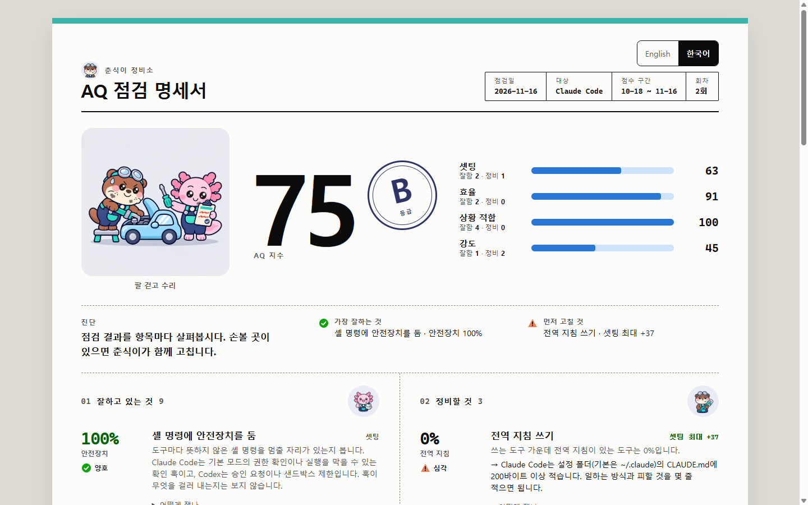

# 춘식이 정비소


Claude Code와 Codex의 AQ 점검입니다. Gemini CLI 기록과 ChatGPT·Claude.ai 채팅도 함께 셉니다. 내 PC에서 도는 프로그램이 Claude Code, Codex, Gemini CLI의 기록과 넣어 준 채팅 내보내기 파일을 읽어, AI 도구를 얼마나 잘 갖추고 쓰는지 점수를 매기고 한 장짜리 결과 화면을 만듭니다.



## 설치

Node.js 22 이상이 있어야 합니다. 명령의 `#main`과 `@main`이 배포한 버전을 받게 합니다. 빼면 개발 중인 브랜치를 받습니다.

| 도구 | 설치 | 부르는 법 |
|---|---|---|
| Claude Code | `claude plugin marketplace add yeunlee1/chunsik-garage#main` 뒤 `claude plugin install chunsik-garage@chunsik-garage` | "AQ 점검해 줘"라고 말하거나 `/chunsik-garage:aq` |
| Codex | `codex plugin marketplace add yeunlee1/chunsik-garage@main` 뒤 `codex plugin add chunsik-garage@chunsik-garage` | "AQ 점검해 줘"라고 말하거나 `/skills`에서 점검 스킬을 고릅니다 |

업데이트는 Claude Code에서 `claude plugin marketplace update chunsik-garage` 뒤 `claude plugin update chunsik-garage@chunsik-garage`를 하고 새 세션을 엽니다. Codex는 `codex plugin marketplace upgrade chunsik-garage`를 하고 다시 켭니다.

## 하는 일

- **점검.** 기록과 셋팅으로 네 기준의 점수를 매기고, 결과 화면을 브라우저로 열고, 터미널에 짧게 알립니다. 항목마다 어떻게 쟀는지 볼 수 있습니다. 결과 화면은 다음 등급으로 가는 셋팅 방법(무엇을 바꾸는지, 지금 값과 목표)을 차례대로 보여 주고, 점수와 등급을 매기는 법도 설명합니다. 설정에 API 키나 토큰이 그대로 적혀 있으면 그것도 짚어 줍니다.
- **정비.** 한동안 쓰지 않은 스킬, 플러그인, MCP 서버를 끕니다. 승인한 것만 바꾸고, 기록을 먼저 남기고, 하나씩 되돌릴 수 있습니다.
- **정밀 점검.** 고른 지침 파일을 읽고 겹치거나 부딪히거나 옮기면 좋을 줄을 알려 줍니다. 점수는 바뀌지 않습니다.
- **세션 시작 알림(Claude Code).** 마지막 점검 뒤 7일이 지났거나 새로 깐 것이 있으면 세션을 시작할 때 한 줄로 알립니다. 켜 달라고 말하면 켜집니다.
- **그대로 둘 항목.** 높은 추론 강도처럼 일부러 그렇게 쓰는 셋팅은 그대로 두라고 말하면 됩니다. 점수에는 그대로 들고, 먼저 고칠 것과 다음 등급 차례에서만 빠집니다.
- **AQ 배지.** README나 깃허브 프로필에 붙일 작은 그림입니다. 최근 점검의 AQ와 등급만 넣어 내 PC에서 만듭니다. "AQ 배지 만들어 줘"라고 말하면 됩니다.
- **웹 채팅.** ChatGPT(설정, 데이터 제어, 데이터 내보내기)나 Claude.ai(설정, 개인정보, 데이터 내보내기)에서 내보내기를 받은 뒤 zip 파일의 경로를 AI에게 주세요. "ChatGPT 내보낸 파일 넣어 줘: C:\Users\me\Downloads\export.zip"처럼 말하면 됩니다. 그 뒤로는 점검이 그 채팅을 쓴 날과 보낸 요청 수도 셉니다. 파일의 자리만 기억하므로 파일을 지우면 점검에서도 빠집니다.

## 개인정보

프로그램과 결과 화면은 네트워크로 요청을 보내지 않습니다. 프로그램이 내놓는 글은 지금 쓰는 AI 대화로 전해집니다. 점검이면 점수와 집계, 결과 화면과 결과 파일의 경로, 고칠 대상의 이름(연결에 실패한 서버, API 키가 적힌 자리 같은 것)입니다. 정비면 정비할 것의 이름, 설정 파일의 경로, 바꿀 항목과 그 값도 전해집니다. API 키의 값과 대화 내용, 지침의 글은 보내지 않습니다. 정밀 점검을 시키면 고른 지침 파일만 AI가 읽습니다.

점검은 MCP 설정과 Claude Code 설정의 `env`에 API 키나 토큰이 그대로 적혀 있는지도 봅니다. 값은 모양만 보고, 보여 주거나 저장하지 않습니다. 결과 화면과 AI에게는 옮길 수 있게 그 자리(서버, 칸, 항목 이름)만 전해지고 값은 가지 않습니다.

ChatGPT나 Claude.ai 내보내기를 넣으면 프로그램이 내 PC에서 읽고 날짜와 개수(내보내기에 있으면 모델 이름도)만 남깁니다. 파일을 복사하지 않고, 대화 글과 제목과 첨부 이름은 캐시에도 결과 화면에도 AI에게도 가지 않습니다.

결과 화면 파일에는 스킬과 프로젝트 폴더의 이름이 들어 있습니다. 자랑할 때는 파일 대신 점수 카드를 쓰세요.

내 PC에서 도는 것은 둘입니다. 스킬이 Node.js로 `skills/aq/scripts/aq.mjs`를 돌리고, Claude Code가 세션을 시작할 때 `hooks/session-start.mjs`를 돌립니다. 훅은 알림을 켜지 않았으면 아무것도 알리지 않습니다. 두 프로그램 모두 네트워크로 요청을 보내지 않습니다.

## 지원 범위

- Node.js 22 이상. 22와 24에서 시험합니다.
- Windows 11에서 만들고 시험했습니다. macOS와 Linux는 임시 홈 폴더 시험으로만 확인했습니다.
- 내 PC의 Claude Code와 Codex에서 쓰도록 만들었습니다. 이 도구들이 PC에 남긴 기록을 읽습니다. ChatGPT와 Claude.ai 채팅은 넣어 준 내보내기 파일로만 세고, Cowork용은 아닙니다.
- Claude Code는 2.1.220부터 2.1.322까지의 기록 형식과 2.1.220부터 2.1.325까지 정비가 바꾸는 설정을 확인했습니다. Codex는 0.166.0의 기록(그리고 0.140부터 0.142까지의 옛 형식)으로 확인했고, 0.169.0까지는 점검이 읽는 기록 모양의 공개 소스를 비교해 확인했습니다.
- Gemini CLI는 PC에 기록과 설정이 있으면 함께 읽습니다. 점검은 Claude Code나 Codex에서 돌립니다. Gemini CLI 확장은 없습니다. 기록 형식은 Gemini CLI 0.68.0의 공개 소스로만 확인했고 실제 기록으로는 아직 확인하지 않았습니다. 기록에 어느 버전이 썼는지 남지 않습니다. Gemini CLI에서는 스킬, 안 쓰는 MCP 서버, MCP 연결 실패와 훅, 추론 강도, 압축을 재지 않고 정비도 하지 않습니다. Gemini CLI에서 신뢰하지 않은 폴더의 설정은 Gemini CLI처럼 빼고 봅니다.
- ChatGPT와 Claude.ai의 내보내기는 넣어 주면 읽습니다. 서비스에서 받은 zip이나 그 안의 `conversations.json`을 받고, `conversations-000.json`처럼 나뉜 파일도 읽습니다. 형식은 내보내기를 읽는 공개 도구들로 확인했고 실제 내보내기로는 아직 확인하지 않았습니다. 내보내기에는 셋팅과 토큰이 없어서 웹 채팅은 쓴 날과 하루 요청 수에만 들고, 내보낸 날까지의 채팅만 있습니다. 최근 30일에 웹 채팅만 썼으면 AQ를 내지 않습니다.

## 남기는 것과 지우는 법

모두 `~/.chunsik-garage/`에 있습니다. 캐시, 결과 화면, 점수 이력, 상태, 알림 표식, 정비 작업 기록, 배지, 넣은 웹 채팅 내보내기의 목록(파일의 자리만)입니다. 플러그인을 지워도 이 폴더는 남습니다.

저장하지 않고 돌린 점검만 다릅니다. 그 결과 화면과 평가 결과 파일(`chunsik-garage-report-<시각>.html`, `chunsik-garage-result-<시각>.json`)은 OS의 임시 폴더에 생기고, 이 도구는 그 파일을 지우지 않습니다. 평가 결과 파일에는 스킬, MCP 서버, 프로젝트의 이름이 들어 있으니 다 보셨으면 직접 지우세요.

- "AQ 점검 파일이 어디 있어?"라고 물으면 폴더와 크기를 알려 줍니다.
- 정리해 달라고 하면 캐시와 오래된 결과를 지우고 가장 최근 결과는 남깁니다.
- 모두 지워 달라고 하면 이력, 상태, 정비 작업 기록, 넣은 내보내기의 목록까지 지웁니다. 내보내기 파일은 그대로입니다. 그 뒤에는 이 도구로 정비를 되돌릴 수 없습니다.
- 지우기 직전에 경로를 다시 보지만, 바로 그때 다른 프로그램이 `~/.chunsik-garage/` 안의 폴더를 바깥을 가리키는 링크로 바꿔치면 막지 못해 바깥 파일이 지워질 수 있습니다. 지우는 동안에는 그 폴더를 건드리지 마세요.

## Codex 샌드박스에서 쓰기

Codex의 기본 샌드박스(작업 공간 쓰기, 필요할 때 승인 요청)에서는 `~/.chunsik-garage/`에 쓰려면 승인이 필요합니다. 늘 허용하려면 `~/.codex/config.toml`의 `writable_roots`에 그 폴더를 더하세요.

```toml
[sandbox_workspace_write]
writable_roots = ["/내/홈/폴더의/절대경로/.chunsik-garage"]
```

승인하지 않아도 저장하지 않는 점검은 돕니다(캐시와 이력이 없습니다). 정비는 바꿀 설정 파일에 쓸 권한이 늘 필요합니다.

## 정비가 막지 못하는 것

- 잠금은 이 도구끼리만 듣습니다. 정비하는 동안에는 다른 Claude Code나 Codex 세션에서 플러그인을 깔거나 설정을 바꾸지 마세요. 마지막으로 확인한 뒤 파일을 갈아 끼우기 전의 아주 짧은 틈에 다른 프로그램이 쓴 변경은 덮일 수 있습니다. 이 도구가 바꾼 것은 작업 기록으로 되돌릴 수 있습니다.
- 이미 떠 있는 Claude Code 세션에는 바로 적용되지 않을 수 있습니다. 새 세션에서 확인하세요. Codex는 다시 시작해야 합니다.

## 라이선스

코드는 MIT입니다(`LICENSE`). `skills/aq/assets/`의 캐릭터 그림은 MIT가 아닙니다. `skills/aq/assets/ART-LICENSE.md`를 보세요. 이 도구가 만든 카드, 결과 화면, 소개 캡처에 든 그림은 그대로 공유해도 됩니다. 그림만 떼어 다른 데 쓰는 것은 허락하지 않습니다.

[English](README.md)
