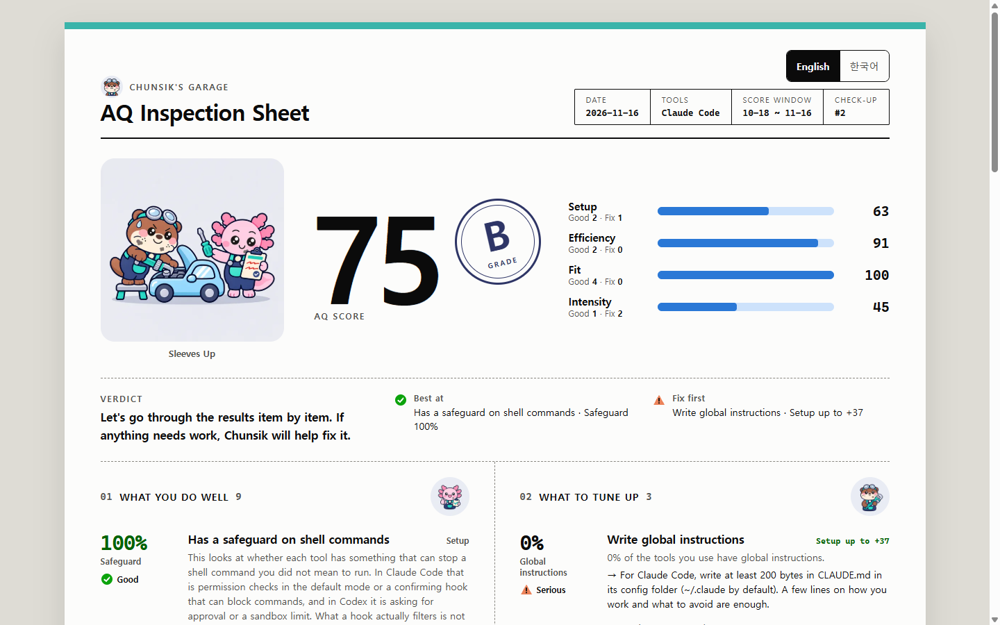

# Chunsik's Garage

AQ checkup for Claude Code and Codex. A program on your own PC reads your local Claude Code and Codex records, scores how well you set up and use these AI coding tools, and writes a one-page report.



## Install

Node.js 22 or later is required. The `#main` and `@main` parts install the released version; without them you get the development branch.

| Tool | Install | Run |
|---|---|---|
| Claude Code | `claude plugin marketplace add yeunlee1/chunsik-garage#main`, then `claude plugin install chunsik-garage@chunsik-garage` | Say "Run an AQ checkup", or use `/chunsik-garage:aq` |
| Codex | `codex plugin marketplace add yeunlee1/chunsik-garage@main`, then `codex plugin add chunsik-garage@chunsik-garage` | Say "Run an AQ checkup", or pick the skill in `/skills` |

## What it does

- **Checkup.** Scores four axes from your records and settings, opens the report page in your browser, and gives a short summary in the terminal. Every item shows how it was measured.
- **Tune-up.** Turns off skills, plugins, and MCP servers you have not used for a while. It changes only the items you approve, writes a record first, and can undo each change.
- **Deep checkup.** Reads the instruction files you pick and points out lines that overlap, conflict, or would be better moved. The score does not change.
- **Session start notices (Claude Code).** One line when a session starts, if 7 days have passed since the last checkup or something new is installed. Ask to turn them on.

## Privacy

The program and the report page send nothing out. The AI receives the scores, the counts, and the names of what to tune up. It does not receive your conversations or the text of your instructions. If you ask for a deep checkup, the AI reads the instruction files you pick.

The report file contains the names of your skills and project folders. Share the score card instead of the file.

## Supported

- Node.js 22 or later. Tested on 22 and 24.
- Built and tested on Windows 11. macOS and Linux are covered only by tests with temporary home folders.
- Claude Code record formats checked on 2.1.220 to 2.1.325. Codex record formats checked on 0.166.0 (and the older format of 0.140 to 0.142).

## What it leaves and how to remove it

Everything lives in `~/.chunsik-garage/`: the cache, the reports, the score history, the state, the notice markers, and the tune-up records. Removing the plugin does not remove this folder.

The only exception is a checkup run without saving. Its report page and result file (`chunsik-garage-report-<time>.html`, `chunsik-garage-result-<time>.json`) go to your OS temp folder, and this tool does not delete them. The result file lists the names of your skills, MCP servers, and projects, so delete it yourself when you no longer need it.

- Ask "where does the AQ checkup keep its files" to see the folder and its size.
- Ask to clean up: the cache and older reports are removed, and the latest report stays.
- Ask to remove everything: the history, the state, and the tune-up records are removed too. After that, tune-ups can no longer be undone with this tool.
- Cleaning checks each path right before deleting it, but it cannot stop another program that swaps a folder inside `~/.chunsik-garage/` for a link at that very moment, which could delete files outside. Leave that folder alone while it is being cleaned.

## Using it in the Codex sandbox

In Codex's default sandbox (workspace-write with approval on request), writing to `~/.chunsik-garage/` needs your approval. To allow it for good, add the folder to `writable_roots` in `~/.codex/config.toml`:

```toml
[sandbox_workspace_write]
writable_roots = ["/absolute/path/to/your/home/.chunsik-garage"]
```

Without approval the checkup still runs without saving (no cache, no history). A tune-up always needs permission to write the settings file it changes.

## What a tune-up cannot prevent

- The lock works only among this tool's own runs. While a tune-up runs, do not install plugins or change settings in other Claude Code or Codex sessions. A change another program writes in the instant between the last check and the file replacement can be overwritten. The tune-up record still lets you undo what this tool changed.
- Open Claude Code sessions may not pick up a change. Check in a new session. Codex needs a restart.

## License

The code is MIT licensed (`LICENSE`). The character art in `skills/aq/assets/` is not covered by the MIT license; see `skills/aq/assets/ART-LICENSE.md`. You may share the art as it appears in the cards, result pages, and screenshots that this tool makes. You may not take the art out of them and use it elsewhere.

[한국어](README.ko.md)
